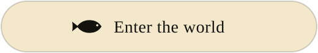
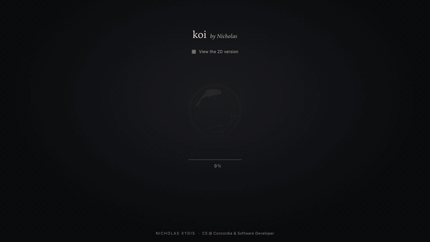
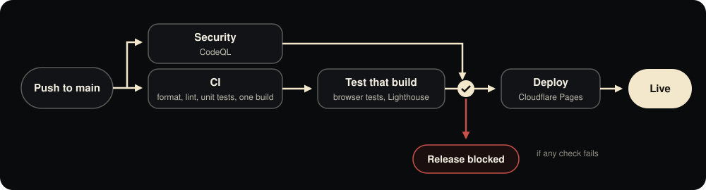
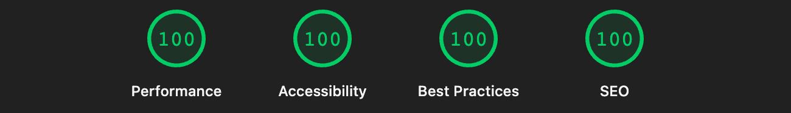
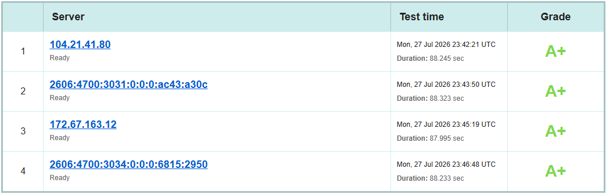
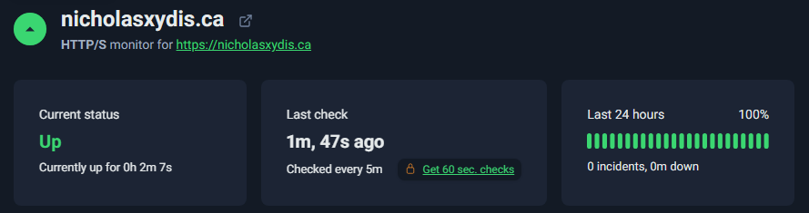

<div align="center">

# Nicholas Xydis | Portfolio

<picture>
  <source media="(prefers-color-scheme: dark)" srcset="https://readme-typing-svg.demolab.com?font=Fira+Code&pause=1000&color=F2EDE1&center=true&vCenter=true&width=700&lines=Bilingual+3D+Portfolio;three.js+%7C+React+%7C+TypeScript;English+and+French+%7C+3D+and+2D;783+Tests+%7C+Lighthouse+90%2B+%7C+Cloudflare+Pages">
  
</picture>

A bilingual portfolio set in a quiet tea house on a moonlit koi pond, built in 3D with a full 2D version beside it.

<br>

<p align="center">
  
  &nbsp;&nbsp;
  
  &nbsp;&nbsp;
  <picture>
    <source media="(prefers-color-scheme: dark)" srcset="https://cdn.simpleicons.org/threedotjs/ffffff">
    
  </picture>
  &nbsp;&nbsp;
  
  &nbsp;&nbsp;
  
  &nbsp;&nbsp;
  
  &nbsp;&nbsp;
  
  &nbsp;&nbsp;
  
</p>

<p align="center">
  <strong>English + French</strong> &nbsp;|&nbsp;
  <strong>3D + 2D</strong> &nbsp;|&nbsp;
  <strong>783 automated tests</strong> &nbsp;|&nbsp;
  <strong>Lighthouse 90+</strong>
</p>

<a href="https://nicholasxydis.ca">
  
</a>

<br>
<br>



</div>

## Features

- **A 3D world.** A tea house on an island in a koi pond, under a moon circled by a white and a black koi. Four places hold the portfolio, the tea counter for About, the scholar's corner for Education, the chess table for Experience and the moon cinema for Projects and Skills.
- **A living scene.** A panda tea master, a crane, two cats watching the chess pieces play themselves, a rabbit and a magpie at the projector, koi in the water and wind in the blossom tree. Day and night, the real moon phase and the visitor's own time on the clock.
- **A full 2D version.** The same content on one page, with no 3D download.
- **Bilingual.** Complete English and French versions, and switching language keeps your place.
- **Every device.** Phones, tablets and desktops in both orientations. Quality adapts to the device, and without hardware graphics the 2D version appears in place.
- **Accessible.** Keyboard navigation, screen reader labels and reduced motion respected throughout.
- **SEO and sharing.** Prerendered pages with titles, canonical URLs, language alternates, structured data, a sitemap and a share picture.
- **Music and sound.** Calm music that starts when you enter, and soft sounds for cards and the pond.

## Architecture

```text
Portfolio/
├─ src/
│  ├─ features/world/    The 3D landing, loading screen, welcome cards, panels and place pins
│  ├─ features/lite/     The 2D page
│  ├─ features/music/    Music and interface sounds
│  ├─ components/koi/    The design kit
│  ├─ content/           Projects, experience, education and skills as JSON with their schemas
│  ├─ locales/           English and French wording
│  ├─ lib/               Language, page titles, analytics and dates
│  └─ routes/            Landing, 2D page and 404
├─ 3d/
│  ├─ viewer/            The three.js viewer
│  └─ worlds/koi/        The packed world, model, lighting, sprites and cinema slides
├─ scripts/              Content check, world packing, sitemap, prerender and release check
├─ e2e/                  Playwright browser tests
└─ .github/workflows/    CI, security and deploy workflows
```

<div align="center">
<pre>
┌─────────────────────────────────────────────────────────┐
│                     Visitor Browser                     │
│     3D world or 2D page, English or French, PostHog     │
└────────────────────────────┬────────────────────────────┘
                             │ HTTPS
┌────────────────────────────▼────────────────────────────┐
│                  Cloudflare Pages Edge                  │
│      Global CDN, TLS, security headers, redirects       │
└────────────────────────────┬────────────────────────────┘
                             │ Build artifact
┌────────────────────────────▼────────────────────────────┐
│                    Vite Static Build                    │
│    Prerendered pages, app bundle, packed 3D world       │
└────────────────────────────┬────────────────────────────┘
                             │ Baked in Blender
┌────────────────────────────▼────────────────────────────┐
│                       Koi World                         │
│     Model, baked day and night lighting, animations     │
└─────────────────────────────────────────────────────────┘
</pre>
</div>

## Tech Stack

| Area     | Stack                                         |
| -------- | --------------------------------------------- |
| Frontend | React, TypeScript, Tailwind CSS, Vite         |
| 3D       | three.js, Blender                             |
| Testing  | Vitest, Testing Library, Playwright, axe-core |
| DevOps   | GitHub Actions, Cloudflare Pages, UptimeRobot |

## Testing

| Suite                  |   Count | Tools                                           |
| ---------------------- | ------: | ----------------------------------------------- |
| Unit / component tests |     276 | Vitest, Testing Library                         |
| End-to-end checks      |     507 | Playwright, axe-core, Chromium, WebKit, Firefox |
| **Total**              | **783** | Desktop, phone, 3D, 2D, English and French      |

End-to-end coverage includes the 3D world on desktop and phone, the 2D fallback, every place in both languages, day and night, and accessibility scans against WCAG 2.1 A and AA.

## CI/CD

| Workflow          | File                                      | Purpose                                                                         |
| ----------------- | ----------------------------------------- | ------------------------------------------------------------------------------- |
| CI                | `.github/workflows/ci.yml`                | Format, lint, unit tests with coverage, one build, browser tests and Lighthouse |
| Security          | `.github/workflows/security.yml`          | CodeQL and dependency review                                                    |
| Deploy Production | `.github/workflows/deploy-production.yml` | Publishes the exact tested build to Cloudflare Pages once CI and Security pass  |

<div align="center">
  
</div>

Lighthouse CI enforces a minimum score of 90 across Performance, Accessibility, Best Practices and SEO on every push, with 85 for performance on the 3D page, which CI can only measure as its no GPU fallback. Any required check failing blocks the release.

## Quality Gates

### Lighthouse

<div align="center">
  
</div>

**100 across all four categories** on desktop for the 3D world, with 90+ enforced in CI on every push.

### SSL Labs

<div align="center">
  
</div>

**Grade A+** across all four Cloudflare edge servers (IPv4 and IPv6).

### Uptime Monitoring

<div align="center">
  
</div>

**External monitoring.** UptimeRobot checks the production site every five minutes.

## License

Copyright © 2026 Nicholas Xydis. All rights reserved. See the [license](LICENSE) for the complete terms.
